# FINAL PROJECT
## MATA KULIAH TEKNOLOGI LOGIKA FUZZY

**SISTEM PENDUKUNG KEPUTUSAN PENENTUAN KUALITAS DAN KELAYAKAN AIR MINUM MENGGUNAKAN KOMBINASI METODE FUZZY MAMDANI DAN K-NEAREST NEIGHBOR (KNN)**

## DAFTAR ISI

## DAFTAR TABEL

## DAFTAR GAMBAR

# BAB I
# PENDAHULUAN

## 1.1 Latar Belakang

Air minum yang aman dan layak dikonsumsi (*potable water*) merupakan kebutuhan mendasar bagi kesehatan masyarakat. Mengacu pada panduan *World Health Organization* (WHO) dan Peraturan Menteri Kesehatan RI Nomor 2 Tahun 2023, kelayakan air minum diukur melalui beberapa parameter fisik dan kimia utama, antara lain derajat keasaman (`ph`), kesadahan air (`Hardness` dalam mg/L), dan kekeruhan air (`Turbidity` dalam NTU). Pengujian terhadap ketiga parameter tersebut penting untuk mendeteksi kontaminasi mineral maupun partikel tersuspensi secara cepat.

Penilaian kelayakan air menggunakan ambang batas kaku (*crisp threshold*) sering kali kurang fleksibel ketika nilai parameter berada di sekitar batas transisi. Selain itu, interaksi non-linear antarparameter membuat sampel air dengan satu parameter ideal belum tentu aman dikonsumsi apabila parameter lainnya menyimpang jauh. Kondisi ketidakpastian inilah yang mendorong penerapan **Sistem Inferensi Fuzzy Metode Mamdani** untuk mengolah gradasi nilai keanggotaan dan aturan pakar menjadi skor indeks kualitas air kontinu (`fuzzy_quality_score`) pada rentang 0 sampai 100.

Di sisi lain, algoritma **K-Nearest Neighbor (KNN)** unggul dalam mengklasifikasikan data berdasarkan kemiripan pola historis menggunakan jarak Euclidean. Akan tetapi, KNN standar yang hanya memakai fitur fisik-kimia mentah cenderung rentan salah klasifikasi pada area perbatasan kelas (*decision boundary*). Oleh karena itu, proyek ini mengintegrasikan Fuzzy Mamdani sebagai ekstraktor fitur berbasis pengetahuan pakar dengan KNN sebagai klasifier akhir pada ruang fitur 4 dimensi, yang diimplementasikan dari awal (*from scratch*) menggunakan Python dan dilengkapi antarmuka grafis berbasis Streamlit.

## 1.2 Rumusan Masalah

1. Bagaimana merancang Sistem Inferensi Fuzzy Mamdani dengan fungsi keanggotaan segitiga simetris dan 27 basis aturan untuk menghasilkan `fuzzy_quality_score` dari parameter `ph`, `Hardness`, dan `Turbidity`?
2. Bagaimana mengintegrasikan `fuzzy_quality_score` ke dalam ruang fitur 4 dimensi pada algoritma KNN berbasis normalisasi Min-Max dan jarak Euclidean secara *from scratch*?
3. Apakah keluaran program Python konsisten dengan hasil perhitungan manual langkah demi langkah pada sampel referensi `S4` dan kasus uji baru `Q*`?
4. Seberapa besar peningkatan performa klasifikasi Model B (Fuzzy-Enhanced KNN 4 fitur) dibandingkan Model A (Baseline KNN 3 fitur) pada berbagai nilai $K$?

## 1.3 Tujuan Pengembangan Aplikasi

1. Merancang dan mengimplementasikan mesin inferensi Fuzzy Mamdani (fuzzifikasi, 27 aturan, inferensi MIN, agregasi MAX, dan defuzzifikasi Centroid analitik) secara mandiri di Python.
2. Membangun pipeline klasifikasi dua tahap Fuzzy-KNN dengan fitur tambahan `fuzzy_quality_score` dan memvalidasinya terhadap perhitungan manual serta implementasi referensi `scikit-learn`.
3. Mengevaluasi perbandingan akurasi, *precision*, *recall*, *F1-score*, dan matriks konfusi antara Baseline KNN (3 fitur) dan Fuzzy-Enhanced KNN (4 fitur) untuk $K \in \{3, 5, 7, 9, 11\}$.
4. Menyediakan aplikasi Sistem Pendukung Keputusan interaktif berbasis Streamlit yang memudahkan simulasi prediksi, eksplorasi aturan fuzzy, dan verifikasi perhitungan.

## 1.4 Manfaat Proyek

1. **Manfaat Akademik:** Menjadi studi kasus terapan integrasi logika fuzzy Mamdani dengan algoritma pembelajaran mesin KNN lengkap beserta pembuktian analitiknya.
2. **Manfaat Praktis:** Membantu pengguna atau penguji kualitas air melakukan skrining awal kelayakan air minum secara cepat, transparan, dan mudah dipahami.
3. **Manfaat Pengembangan:** Menyediakan arsitektur kode Python modular yang dapat dikembangkan dengan tambahan parameter kualitas air lain maupun metode klasifikasi lanjutan.

## 1.5 Batasan Masalah

1. Dataset bersumber dari repositori publik Kaggle (*Water Quality and Potability*, `water_potability.csv`) yang dibersihkan menjadi 600 sampel seimbang (300 `Potable` dan 300 `Not Potable`).
2. Variabel input Fuzzy Mamdani dibatasi pada tiga parameter utama yang paling berpengaruh, yaitu `ph` ($[0, 14]$), `Hardness` ($[60, 300]$ mg/L), dan `Turbidity` ($[1, 6]$ NTU).
3. Fungsi keanggotaan menggunakan kurva segitiga simetris dengan 3 himpunan linguistik per variabel, sehingga membentuk tepat $3^3 = 27$ basis aturan.
4. Evaluasi klasifikasi menggunakan pembagian data terstratifikasi 80:20 (480 data latih, 120 data uji) dengan normalisasi Min-Max yang dihitung khusus dari data latih agar bebas kebocoran data (*data leakage*).

# BAB II
# LANDASAN TEORI

## 2.1 Konsep Logika Fuzzy dan Sistem Inferensi Fuzzy (FIS) Mamdani

Logika fuzzy yang diperkenalkan oleh Zadeh (1965) memperluas logika himpunan klasik dengan mengizinkan suatu elemen memiliki derajat keanggotaan kontinu pada interval $[0, 1]$. Pendekatan ini memungkinkan representasi konsep linguistik seperti "asam", "netral", atau "agak keruh" secara matematis tanpa batas pemisah yang kaku.

### 2.1.1 Fungsi Keanggotaan Segitiga Simetris

Fungsi keanggotaan segitiga (*triangular membership function*) ditentukan oleh tiga parameter $(a, b, c)$ dengan $a \le b \le c$, di mana $b$ adalah titik puncak ($\mu(b) = 1$) serta $a$ dan $c$ adalah batas bawah dan atas. Persamaan matematis kurva segitiga dirumuskan sebagai berikut:

$$\mu(x; a, b, c) = \begin{cases} 0, & x \le a \text{ atau } x \ge c \\ \dfrac{x - a}{b - a}, & a < x \le b \\ \dfrac{c - x}{c - b}, & b < x < c \end{cases}$$

Pada sistem ini, tiga kurva segitiga untuk setiap variabel disusun secara simetris dan saling bersinggungan sehingga jumlah seluruh derajat keanggotaan pada setiap titik $x$ dalam domain selalu bernilai satu ($\sum \mu_i(x) = 1$). Untuk himpunan tepi kiri berlaku $a = b$ (bahu kiri bernilai 1 di $x \le b$), sedangkan untuk himpunan tepi kanan berlaku $b = c$ (bahu kanan bernilai 1 di $x \ge b$).

### 2.1.2 Tahapan Sistem Inferensi Fuzzy Metode Mamdani

Sistem Inferensi Fuzzy Mamdani (Mamdani & Assilian, 1975) memproses masukan numerik menjadi keluaran numerik melalui empat tahapan utama:

1. **Fuzzifikasi:** Mengubah nilai input tegas (*crisp*) menjadi derajat keanggotaan $\mu(x)$ pada masing-masing himpunan linguistik.
2. **Evaluasi Aturan dan Implikasi (MIN):** Setiap aturan berbentuk `IF X1 is A1 AND X2 is A2 AND X3 is A3 THEN Y is B` dihitung kekuatan penyulutannya (*firing strength*) menggunakan operator `MIN`:
$$\alpha_r = \min(\mu_{A_{r1}}(x_1), \mu_{A_{r2}}(x_2), \mu_{A_{r3}}(x_3))$$
Selanjutnya kurva konsekuen $\mu_{B_r}(z)$ dipotong setinggi $\alpha_r$ melalui implikasi `MIN`: $\mu_{B'_r}(z) = \min(\alpha_r, \mu_{B_r}(z))$.
3. **Agregasi (MAX):** Menggabungkan seluruh kurva konsekuen hasil implikasi dari seluruh aturan aktif menjadi satu kurva gabungan $\mu_{\text{agg}}(z) = \max_r \mu_{B'_r}(z)$.
4. **Defuzzifikasi Centroid (*Center of Area*):** Menghitung titik pusat massa dari area kurva agregasi $\mu_{\text{agg}}(z)$ pada domain output $[0, 100]$:
$$z^* = \dfrac{\int_{0}^{100} z \cdot \mu_{\text{agg}}(z)\,dz}{\int_{0}^{100} \mu_{\text{agg}}(z)\,dz}$$
Karena fungsi keanggotaan berbentuk garis linear per segmen (*piecewise linear*), integral luas dan momen dapat dihitung secara analitik eksak tanpa galat diskretisasi.

## 2.2 Algoritma K-Nearest Neighbor (KNN)

Algoritma K-Nearest Neighbor (Cover & Hart, 1967) merupakan metode klasifikasi *non-parametric* berbasis instans yang menentukan label kelas suatu data uji berdasarkan mayoritas kelas dari $K$ data latih terdekat.

### 2.2.1 Normalisasi Fitur (*Min-Max Scaling*)

Karena variabel input memiliki rentang skala yang jauh berbeda (misalnya `ph` pada rentang 0 sampai 14, sedangkan `Hardness` mencapai 300 mg/L), setiap fitur ke-$j$ harus dinormalisasi ke rentang $[0, 1]$ sebelum menghitung jarak:

$$x'_{ij} = \dfrac{x_{ij} - x_{\min, j}}{x_{\max, j} - x_{\min, j}}$$

Parameter $x_{\min, j}$ dan $x_{\max, j}$ dihitung hanya dari data latih (*training set*), lalu diterapkan untuk mentransformasi data uji (*testing set*) guna menghindari kebocoran data.

### 2.2.2 Metrik Jarak Euclidean dan Pemungutan Suara Mayoritas

Kemiripan antara vektor data uji ternormalisasi $\mathbf{x}'_q$ dan data latih $\mathbf{x}'_i$ pada ruang berdimensi $d$ diukur menggunakan jarak Euclidean:

$$d(\mathbf{x}'_q, \mathbf{x}'_i) = \sqrt{\sum_{j=1}^{d} (x'_{qj} - x'_{ij})^2}$$

Setelah seluruh jarak diurutkan dari terkecil ke terbesar, diambil $K$ tetangga terdekat $\mathcal{N}_K(\mathbf{x}'_q)$. Kelas prediksi $\hat{y}_q$ ditetapkan berdasarkan pemungutan suara mayoritas (*majority voting*), dengan pemilihan nilai $K$ ganjil untuk mencegah hasil seri pada klasifikasi biner.

## 2.3 Integrasi Metode Fuzzy Mamdani dan K-Nearest Neighbor (KNN)

Integrasi Fuzzy Mamdani dan KNN dalam proyek ini mengadopsi arsitektur kombinasi dua tahap (*two-stage feature enrichment*). Pada tahap pertama, mesin Fuzzy Mamdani mengevaluasi kombinasi non-linear dari `ph`, `Hardness`, dan `Turbidity` melalui 27 aturan pakar untuk menghasilkan satu fitur ringkas bernama `fuzzy_quality_score` ($Y \in [0, 100]$).

Pada tahap kedua, skor kualitas air fuzzy tersebut digabungkan dengan ketiga fitur fisik-kimia asli menjadi vektor 4 dimensi $\mathbf{x} = [X_1, X_2, X_3, Y]$, kemudian dinormalisasi dengan Min-Max Scaling dan diklasifikasikan oleh KNN. Pendekatan ini menggabungkan transparansi pengetahuan pakar dari logika fuzzy dengan kemampuan pengenalan pola distribusi data historis dari KNN.

## 2.4 Parameter Kualitas Air Minum dan Studi Literatur

Acuan baku mutu parameter fisik-kimia air minum menurut WHO (2022) dan Permenkes RI No. 2 Tahun 2023 diringkas pada **Tabel 2.1**, sedangkan perbandingan singkat penelitian terdahulu disajikan pada **Tabel 2.2**.

**Tabel 2.1** Standar Baku Mutu Parameter Fisik-Kimia Air Minum (WHO & Permenkes RI)

| Parameter | Satuan | Standar WHO (2022) | Standar Permenkes RI No. 2/2023 | Dampak Penyimpangan |
| :--- | :---: | :---: | :---: | :--- |
| Derajat Keasaman (`ph`) | pH | 6.5 - 8.5 | 6.5 - 8.5 | Air terlalu asam memicu korosi pipa; terlalu basa menyebabkan rasa pahit dan kerak. |
| Kesadahan (`Hardness`) | mg/L | < 200 (ideal < 150) | Maks. 500 | Kesadahan tinggi menimbulkan endapan kapur dan menurunkan kualitas konsumsi. |
| Kekeruhan (`Turbidity`) | NTU | < 5.0 (ideal < 1.0) | Maks. 3.0 | Kekeruhan tinggi menandakan partikel tersuspensi dan risiko mikroorganisme patogen. |

**Tabel 2.2** Perbandingan Singkat Studi Literatur Terdahulu

| Referensi | Metode Utama | Ringkasan Temuan | Perbedaan dengan Proyek Ini |
| :--- | :--- | :--- | :--- |
| Kusumadewi & Purnomo (2010) | Fuzzy Mamdani | Efektif memetakan variabel lingkungan ke skor linguistik dan indeks mutu. | Proyek ini melanjutkan output Fuzzy Mamdani sebagai fitur klasifikasi biner KNN. |
| Keller et al. (1985) | Fuzzy KNN (FKNN) | Memberikan derajat keanggotaan kelas berdasarkan jarak tetangga. | Proyek ini memisahkan ekstraksi pengetahuan pakar (Mamdani) sebelum klasifikasi KNN. |
| Kadiwal (2021) | ML pada *Water Potability* | Dataset kualitas air memiliki batas kelas yang tumpang tindih pada fitur mentah. | Proyek ini menguji langsung dampak fitur `fuzzy_quality_score` terhadap akurasi KNN. |

# BAB III
# ANALISIS DAN PERANCANGAN SISTEM

## 3.1 Analisis Kebutuhan Sistem

Kebutuhan fungsional sistem mencakup prapemrosesan dataset `water_potability.csv`, perhitungan skor Fuzzy Mamdani dari input numerik, klasifikasi kelayakan air menggunakan Model A (3 fitur) dan Model B (4 fitur), serta visualisasi interaktif melalui 6 halaman GUI Streamlit. Dari sisi non-fungsional, seluruh inti algoritma Fuzzy Mamdani dan KNN wajib dibangun *from scratch* dengan Python agar transparan, deterministik, bebas *data leakage*, dan dapat diverifikasi dengan selisih nol terhadap hitungan manual.

## 3.2 Deskripsi Dataset Publik Kaggle (`water_potability.csv`)

Dataset mentah berasal dari Kaggle (*Water Quality and Potability*) yang terdiri atas 3.276 sampel dengan beberapa nilai kosong (*missing values*) dan ketidakseimbangan kelas. Tahap prapemrosesan pada `src/prepare_dataset.py` menghapus baris dengan nilai kosong pada atribut kunci, memfilter nilai ekstrem di luar domain fisik wajar, serta menyusun 600 sampel bersih yang seimbang (300 `Potable` dan 300 `Not Potable`).

Data bersih (`water_potability_clean.csv`) dibagi secara terstratifikasi dengan rasio 80:20 menjadi 480 data latih (240 `Potable`, 240 `Not Potable`) dan 120 data uji (60 `Potable`, 60 `Not Potable`). Statistik deskriptif seluruh fitur pada 600 sampel bersih ditunjukkan pada **Tabel 3.1**.

**Tabel 3.1** Statistik Deskriptif Variabel Numerik Dataset Bersih (`water_potability_clean.csv`, $N = 600$)

| Variabel | Satuan | Min | Q1 (25%) | Median | Mean | Q3 (75%) | Max | Std Dev |
| :--- | :---: | :---: | :---: | :---: | :---: | :---: | :---: | :---: |
| **`ph`** ($X_1$) | pH (0-14) | 1.4318 | 6.0696 | 7.0393 | 7.1165 | 8.0883 | 13.3499 | 1.7151 |
| **`Hardness`** ($X_2$) | mg/L | 73.4922 | 175.6315 | 197.2792 | 195.2735 | 217.4722 | 286.5680 | 34.0901 |
| **`Turbidity`** ($X_3$) | NTU | 1.8444 | 3.4430 | 3.9646 | 3.9713 | 4.5113 | 5.9568 | 0.7570 |
| **`Solids`** | ppm | 1372.0900 | 16134.7500 | 21384.6400 | 22237.8212 | 27125.6475 | 55334.7000 | 8482.9323 |
| **`Chloramines`** | ppm | 2.4586 | 6.2837 | 7.3009 | 7.2088 | 8.1549 | 13.1270 | 1.6174 |
| **`Conductivity`** | $\mu\text{S/cm}$ | 201.6200 | 365.6750 | 424.3900 | 424.4471 | 479.5575 | 753.3400 | 79.6734 |
| **`fuzzy_quality_score`** ($Y$) | Skor (0-100) | 20.3883 | 44.3975 | 47.2159 | 46.3661 | 49.2897 | 60.0580 | 4.8023 |

## 3.3 Variabel Input-Output, Fungsi Keanggotaan, dan 27 Basis Aturan

### 3.3.1 Fungsi Keanggotaan Segitiga Simetris

Sistem Fuzzy Mamdani menggunakan 3 variabel input (`ph`, `Hardness`, `Turbidity`) dan 1 variabel output (`water_quality_score`). Masing-masing variabel dipartisi menjadi 3 himpunan segitiga simetris $(a, b, c)$ sebagaimana dirinci pada **Tabel 3.2** dan divisualisasikan pada **Gambar 3.1**.

**Tabel 3.2** Parameter Fungsi Keanggotaan Segitiga Simetris $(a, b, c)$

| Variabel & Domain | Himpunan Fuzzy | Parameter $(a, b, c)$ | Persamaan Derajat Keanggotaan $\mu(x)$ |
| :--- | :--- | :---: | :--- |
| **`ph`** ($X_1$)<br>Domain: $[0.0, 14.0]$ | `Acidic` | $(0.0, 0.0, 7.0)$ | $\max(0, \min(1, (7.0 - x_1)/7.0))$ |
| | `Neutral` | $(0.0, 7.0, 14.0)$ | $\max(0, \min(x_1/7.0, (14.0 - x_1)/7.0))$ |
| | `Alkaline` | $(7.0, 14.0, 14.0)$ | $\max(0, \min(1, (x_1 - 7.0)/7.0))$ |
| **`Hardness`** ($X_2$)<br>Domain: $[60.0, 300.0]$ | `Soft` | $(60.0, 60.0, 180.0)$ | $\max(0, \min(1, (180.0 - x_2)/120.0))$ |
| | `Moderate` | $(60.0, 180.0, 300.0)$ | $\max(0, \min((x_2 - 60.0)/120.0, (300.0 - x_2)/120.0))$ |
| | `Hard` | $(180.0, 300.0, 300.0)$ | $\max(0, \min(1, (x_2 - 180.0)/120.0))$ |
| **`Turbidity`** ($X_3$)<br>Domain: $[1.0, 6.0]$ | `Clear` | $(1.0, 1.0, 3.5)$ | $\max(0, \min(1, (3.5 - x_3)/2.5))$ |
| | `Moderate` | $(1.0, 3.5, 6.0)$ | $\max(0, \min((x_3 - 1.0)/2.5, (6.0 - x_3)/2.5))$ |
| | `Turbid` | $(3.5, 6.0, 6.0)$ | $\max(0, \min(1, (x_3 - 3.5)/2.5))$ |
| **`water_quality_score`** ($Y$)<br>Domain: $[0.0, 100.0]$ | `Poor` | $(0.0, 0.0, 50.0)$ | $\max(0, \min(1, (50.0 - z)/50.0))$ |
| | `Moderate` | $(0.0, 50.0, 100.0)$ | $\max(0, \min(z/50.0, (100.0 - z)/50.0))$ |
| | `Good` | $(50.0, 100.0, 100.0)$ | $\max(0, \min(1, (z - 50.0)/50.0))$ |

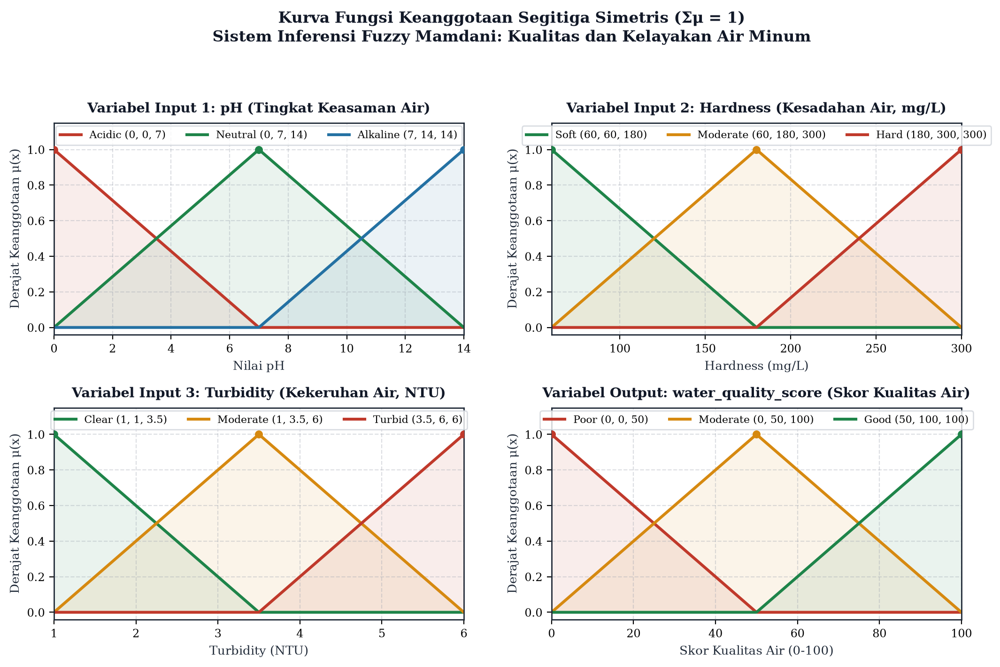

**Gambar 3.1** Kurva Fungsi Keanggotaan Segitiga Simetris untuk Variabel Input dan Output

### 3.3.2 Basis Aturan Lengkap (*Complete Rule Base*) 27 Aturan

Kombinasi seluruh himpunan fuzzy dari 3 variabel input menghasilkan 27 aturan (`R01` s.d. `R27`) yang mencakup 3 aturan `Good`, 9 aturan `Moderate`, dan 15 aturan `Poor`. Konsekuen `Good` hanya diberikan bila `ph` netral dan kesadahan serta kekeruhan berada pada kondisi rendah hingga sedang. Daftar lengkap 27 aturan disajikan pada **Tabel 3.3**.

**Tabel 3.3** Basis Aturan Lengkap Fuzzy Mamdani 27 Aturan (`R01` s.d. `R27`)

| Rule | `ph` ($X_1$) | `Hardness` ($X_2$) | `Turbidity` ($X_3$) | Output ($Y$) | Rule | `ph` ($X_1$) | `Hardness` ($X_2$) | `Turbidity` ($X_3$) | Output ($Y$) |
| :---: | :---: | :---: | :---: | :---: | :---: | :---: | :---: | :---: | :---: |
| **R01** | Acidic | Soft | Clear | **Moderate** | **R15** | Neutral | Moderate | Turbid | **Poor** |
| **R02** | Acidic | Soft | Moderate | **Moderate** | **R16** | Neutral | Hard | Clear | **Moderate** |
| **R03** | Acidic | Soft | Turbid | **Poor** | **R17** | Neutral | Hard | Moderate | **Poor** |
| **R04** | Acidic | Moderate | Clear | **Moderate** | **R18** | Neutral | Hard | Turbid | **Poor** |
| **R05** | Acidic | Moderate | Moderate | **Poor** | **R19** | Alkaline | Soft | Clear | **Moderate** |
| **R06** | Acidic | Moderate | Turbid | **Poor** | **R20** | Alkaline | Soft | Moderate | **Moderate** |
| **R07** | Acidic | Hard | Clear | **Poor** | **R21** | Alkaline | Soft | Turbid | **Poor** |
| **R08** | Acidic | Hard | Moderate | **Poor** | **R22** | Alkaline | Moderate | Clear | **Moderate** |
| **R09** | Acidic | Hard | Turbid | **Poor** | **R23** | Alkaline | Moderate | Moderate | **Poor** |
| **R10** | Neutral | Soft | Clear | **Good** | **R24** | Alkaline | Moderate | Turbid | **Poor** |
| **R11** | Neutral | Soft | Moderate | **Good** | **R25** | Alkaline | Hard | Clear | **Poor** |
| **R12** | Neutral | Soft | Turbid | **Moderate** | **R26** | Alkaline | Hard | Moderate | **Poor** |
| **R13** | Neutral | Moderate | Clear | **Good** | **R27** | Alkaline | Hard | Turbid | **Poor** |
| **R14** | Neutral | Moderate | Moderate | **Moderate** | | | | | |

## 3.4 Arsitektur Sistem dan Flowchart Algoritma

Alur pengolahan sistem dimulai dari pembersihan dataset dan ekstraksi fitur `fuzzy_quality_score` menggunakan mesin Mamdani, kemudian dilanjutkan dengan normalisasi Min-Max dan klasifikasi KNN pada Model A (3 fitur) serta Model B (4 fitur). Rancangan arsitektur pipeline dan flowchart komputasi *end-to-end* ditunjukkan pada **Gambar 3.2** dan **Gambar 3.3**.

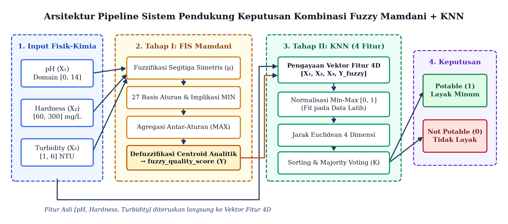

**Gambar 3.2** Diagram Arsitektur Pipeline Sistem Pendukung Keputusan Kombinasi Fuzzy Mamdani dan KNN

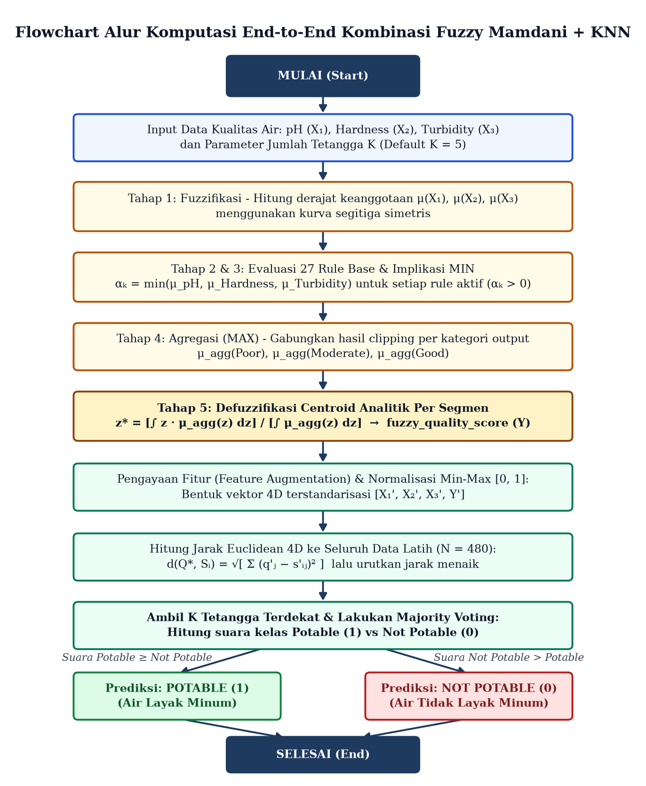

**Gambar 3.3** Flowchart Alur Komputasi *End-to-End* Kombinasi Fuzzy Mamdani dan KNN

## 3.5 Perhitungan Manual Langkah demi Langkah

Untuk memverifikasi kebenaran implementasi algoritma, disiapkan 5 sampel referensi (`S1` s.d. `S5`) pada `data/processed/manual_calc_sample.csv` sebagaimana tercantum pada **Tabel 3.4**. Perhitungan manual dilakukan secara rinci untuk dua kasus, yaitu sampel referensi `S4` (`WQP-M04`) dan kasus uji baru `Q*`.

**Tabel 3.4** Data 5 Sampel Referensi Perhitungan Manual (`S1` s.d. `S5`)

| Kode | Sample ID | `ph` ($X_1$) | `Hardness` ($X_2$) | `Turbidity` ($X_3$) | `fuzzy_quality_score` ($Y$) | Kelas Aktual |
| :---: | :---: | :---: | :---: | :---: | :---: | :---: |
| **S1** | `WQP-M01` | 3.50 | 240.0 | 4.750 | **44.0476** | Not Potable (0) |
| **S2** | `WQP-M02` | 10.50 | 240.0 | 4.750 | **44.0476** | Not Potable (0) |
| **S3** | `WQP-M03` | 7.00 | 180.0 | 3.500 | **50.0000** | Not Potable (0) |
| **S4** | `WQP-M04` | 7.00 | 120.0 | 2.250 | **55.9524** | Potable (1) |
| **S5** | `WQP-M05` | 7.00 | 90.0 | 1.625 | **64.6739** | Potable (1) |

### 3.5.1 Perhitungan Manual Fuzzy Mamdani Kasus 1: Sampel Referensi `S4`

Sampel `S4` memiliki nilai input $X_1 = 7.00$, $X_2 = 120.0$ mg/L, dan $X_3 = 2.25$ NTU.

1. **Fuzzifikasi:**
   - `ph` ($7.00$): $\mu_{\text{Acidic}} = 0.0000$, $\mu_{\text{Neutral}} = 1.0000$, $\mu_{\text{Alkaline}} = 0.0000$.
   - `Hardness` ($120.0$): $\mu_{\text{Soft}} = (180 - 120)/120 = 0.5000$, $\mu_{\text{Moderate}} = (120 - 60)/120 = 0.5000$, $\mu_{\text{Hard}} = 0.0000$.
   - `Turbidity` ($2.25$): $\mu_{\text{Clear}} = (3.5 - 2.25)/2.5 = 0.5000$, $\mu_{\text{Moderate}} = (2.25 - 1.0)/2.5 = 0.5000$, $\mu_{\text{Turbid}} = 0.0000$.

2. **Evaluasi Aturan (MIN) dan Agregasi (MAX):** Dari 27 aturan, tepat 4 aturan aktif dengan $\alpha_r > 0$ seperti pada **Tabel 3.5**. Agregasi MAX menghasilkan $\alpha_{\text{Poor}} = 0.0000$, $\alpha_{\text{Moderate}} = 0.5000$, dan $\alpha_{\text{Good}} = 0.5000$.

**Tabel 3.5** Evaluasi Rule Aktif dan Implikasi MIN pada Sampel `S4`

| Rule | Anteseden ($X_1, X_2, X_3$) | $\mu(X_1)$ | $\mu(X_2)$ | $\mu(X_3)$ | $\alpha_r = \min$ | Konsekuen ($Y$) |
| :---: | :--- | :---: | :---: | :---: | :---: | :---: |
| **R10** | `(Neutral, Soft, Clear)` | 1.0000 | 0.5000 | 0.5000 | **0.5000** | **Good** |
| **R11** | `(Neutral, Soft, Moderate)` | 1.0000 | 0.5000 | 0.5000 | **0.5000** | **Good** |
| **R13** | `(Neutral, Moderate, Clear)` | 1.0000 | 0.5000 | 0.5000 | **0.5000** | **Good** |
| **R14** | `(Neutral, Moderate, Moderate)` | 1.0000 | 0.5000 | 0.5000 | **0.5000** | **Moderate** |

3. **Defuzzifikasi Centroid Analitik:** Kurva agregasi $\mu_{\text{agg}}(z)$ terbagi atas dua segmen: garis naik $\mu(z) = 0.02z$ pada $[0, 25]$ dan garis mendatar $\mu(z) = 0.50$ pada $[25, 100]$. Hasil integrasi luas dan momen disajikan pada **Tabel 3.6**.

**Tabel 3.6** Integral Luas dan Momen Defuzzifikasi Centroid Sampel `S4`

| Segmen | Interval $z$ | Persamaan $\mu_{\text{agg}}(z)$ | Luas $A_i = \int \mu(z)\,dz$ | Momen $M_i = \int z\cdot\mu(z)\,dz$ |
| :---: | :---: | :--- | :---: | :---: |
| **Segmen 1** | $[0.00, 25.00]$ | $\mu(z) = 0.0200z$ | 6.2500 | 104.1667 |
| **Segmen 2** | $[25.00, 100.00]$ | $\mu(z) = 0.5000$ | 37.5000 | 2343.7500 |
| **Total** | $[0.00, 100.00]$ | Total Luas & Momen | **43.7500** | **2447.9167** |

$$z^*_{S4} = \dfrac{2447.9167}{43.7500} = 55.9524$$

### 3.5.2 Perhitungan Manual End-to-End Kasus 2: Kasus Uji Baru `Q*`

Kasus uji baru $Q^*$ memiliki input $X_1 = 5.25$, $X_2 = 150.0$ mg/L, dan $X_3 = 2.25$ NTU.

#### Bagian A: Skor Kualitas Air Fuzzy Mamdani untuk `Q*`

1. **Fuzzifikasi:**
   - `ph` ($5.25$): $\mu_{\text{Acidic}} = 0.2500$, $\mu_{\text{Neutral}} = 0.7500$, $\mu_{\text{Alkaline}} = 0.0000$.
   - `Hardness` ($150.0$): $\mu_{\text{Soft}} = 0.2500$, $\mu_{\text{Moderate}} = 0.7500$, $\mu_{\text{Hard}} = 0.0000$.
   - `Turbidity` ($2.25$): $\mu_{\text{Clear}} = 0.5000$, $\mu_{\text{Moderate}} = 0.5000$, $\mu_{\text{Turbid}} = 0.0000$.

2. **Evaluasi Aturan dan Agregasi:** Terdapat 8 aturan aktif seperti pada **Tabel 3.7**. Agregasi MAX menghasilkan $\alpha_{\text{Poor}} = 0.2500$, $\alpha_{\text{Moderate}} = 0.5000$, dan $\alpha_{\text{Good}} = 0.5000$.

**Tabel 3.7** Evaluasi Rule Aktif dan Implikasi MIN pada Kasus Uji `Q*`

| Rule | Anteseden ($X_1, X_2, X_3$) | $\mu(X_1)$ | $\mu(X_2)$ | $\mu(X_3)$ | $\alpha_r = \min$ | Konsekuen ($Y$) |
| :---: | :--- | :---: | :---: | :---: | :---: | :---: |
| **R01** | `(Acidic, Soft, Clear)` | 0.2500 | 0.2500 | 0.5000 | 0.2500 | Moderate |
| **R02** | `(Acidic, Soft, Moderate)` | 0.2500 | 0.2500 | 0.5000 | 0.2500 | Moderate |
| **R04** | `(Acidic, Moderate, Clear)` | 0.2500 | 0.7500 | 0.5000 | 0.2500 | Moderate |
| **R05** | `(Acidic, Moderate, Moderate)` | 0.2500 | 0.7500 | 0.5000 | 0.2500 | Poor |
| **R10** | `(Neutral, Soft, Clear)` | 0.7500 | 0.2500 | 0.5000 | 0.2500 | Good |
| **R11** | `(Neutral, Soft, Moderate)` | 0.7500 | 0.2500 | 0.5000 | 0.2500 | Good |
| **R13** | `(Neutral, Moderate, Clear)` | 0.7500 | 0.7500 | 0.5000 | **0.5000** | **Good** |
| **R14** | `(Neutral, Moderate, Moderate)` | 0.7500 | 0.7500 | 0.5000 | **0.5000** | **Moderate** |

3. **Defuzzifikasi Centroid:** Kurva agregasi terbagi dalam 3 segmen sesuai **Tabel 3.8**, menghasilkan skor $z^*_{Q^*} = 2454.4271 / 45.3125 = 54.1667$.

**Tabel 3.8** Integral Luas dan Momen Defuzzifikasi Centroid Kasus Uji `Q*`

| Segmen | Interval $z$ | Persamaan $\mu_{\text{agg}}(z)$ | Luas $A_i$ | Momen $M_i$ |
| :---: | :---: | :--- | :---: | :---: |
| **Segmen 1** | $[0.00, 12.50]$ | $\mu(z) = 0.2500$ | 3.1250 | 19.5312 |
| **Segmen 2** | $[12.50, 25.00]$ | $\mu(z) = 0.0200z$ | 4.6875 | 91.1458 |
| **Segmen 3** | $[25.00, 100.00]$ | $\mu(z) = 0.5000$ | 37.5000 | 2343.7500 |
| **Total** | $[0.00, 100.00]$ | Total Luas & Momen | **45.3125** | **2454.4271** |

#### Bagian B: Normalisasi Min-Max, Jarak Euclidean, dan Klasifikasi KNN ($K = 3$)

Parameter minimum dan maksimum dari 5 sampel referensi (`S1` s.d. `S5`) disajikan pada **Tabel 3.9**.

**Tabel 3.9** Parameter Normalisasi Min-Max pada 5 Sampel Referensi

| Parameter | `ph` ($X_1$) | `Hardness` ($X_2$) | `Turbidity` ($X_3$) | `fuzzy_quality_score` ($Y$) |
| :--- | :---: | :---: | :---: | :---: |
| Minimum ($x_{\min}$) | 3.5000 | 90.0000 | 1.6250 | 44.0476 |
| Maksimum ($x_{\max}$) | 10.5000 | 240.0000 | 4.7500 | 64.6739 |
| Rentang ($x_{\max} - x_{\min}$) | **7.0000** | **150.0000** | **3.1250** | **20.6263** |

Dengan rumus Min-Max Scaling, vektor fitur $Q^* = [5.25, 150.0, 2.25, 54.1667]$ ditransformasikan menjadi $\mathbf{x}'_{Q^*} = [0.2500, 0.4000, 0.2000, 0.4906]$. Perhitungan jarak Euclidean 4 dimensi terhadap kelima sampel referensi dan peringkat tetangga terdekatnya dirangkum pada **Tabel 3.10**.

**Tabel 3.10** Perhitungan Jarak Euclidean 4 Fitur dan Peringkat KNN ($K = 3$) untuk `Q*`

| Peringkat | Sampel | Vektor Ternormalisasi $[X'_1, X'_2, X'_3, Y']$ | $\sum \Delta^2$ | Jarak $d(Q^*, S_i)$ | Kelas Aktual | Status ($K=3$) |
| :---: | :---: | :---: | :---: | :---: | :---: | :---: |
| **1** | **S4** | `[0.5000, 0.2000, 0.2000, 0.5772]` | 0.1100 | **0.3317** | **Potable** | Tetangga #1 |
| **2** | **S3** | `[0.5000, 0.6000, 0.6000, 0.2886]` | 0.3033 | **0.5507** | **Not Potable** | Tetangga #2 |
| **3** | **S5** | `[0.5000, 0.0000, 0.0000, 1.0000]` | 0.5220 | **0.7225** | **Potable** | Tetangga #3 |
| 4 | S1 | `[0.0000, 1.0000, 1.0000, 0.0000]` | 1.3032 | 1.1416 | Not Potable | Di luar $K=3$ |
| 5 | S2 | `[1.0000, 1.0000, 1.0000, 0.0000]` | 1.8032 | 1.3428 | Not Potable | Di luar $K=3$ |

Berdasarkan 3 tetangga terdekat (`S4`, `S3`, `S5`), diperoleh suara 2 `Potable` berbanding 1 `Not Potable`, sehingga kasus uji `Q*` diprediksi sebagai **`Potable`** (Layak Minum).

## 3.6 Perancangan Antarmuka Pengguna Grafis (GUI Streamlit)

Aplikasi web interaktif dirancang menggunakan pola navigasi *sidebar* dengan 6 halaman terpisah: **01 · Dashboard**, **02 · Input & Dataset**, **03 · Step-by-Step Process**, **04 · Classification Results**, **05 · Model Evaluation**, dan **06 · Docs & Guide**. Pemisahan ini memudahkan pengguna berpindah dari simulasi prediksi langsung hingga penelusuran perhitungan *white-box* dan evaluasi model tanpa tampilan yang padat.

## 3.7 Rancangan Pengujian Sistem

Pengujian dilakukan pada tiga lapis: (1) validasi *zero-discrepancy* antara perhitungan manual Bab III dengan keluaran kode Python, (2) uji kesesuaian prediksi `KNNClassifierScratch` terhadap `KNeighborsClassifier` milik `scikit-learn` (target kesesuaian 100%), dan (3) uji komparatif Model A (3 fitur) vs Model B (4 fitur) pada 120 data uji untuk nilai $K \in \{3, 5, 7, 9, 11\}$ menggunakan metrik *Accuracy*, *Precision*, *Recall*, *F1-Score*, dan *Confusion Matrix*.

# BAB IV
# IMPLEMENTASI DAN PEMBAHASAN

## 4.1 Lingkungan Implementasi dan Library Python

Sistem dikembangkan pada lingkungan Python 3 menggunakan pustaka standar komputasi numerik dan visualisasi sebagaimana dirinci pada **Tabel 4.1**. Pustaka `scikit-learn` hanya dipakai sebagai pembanding validasi, bukan sebagai mesin prediksi utama.

**Tabel 4.1** Spesifikasi Lingkungan Implementasi dan Pustaka Python

| Komponen / Library | Fungsi Utama dalam Sistem |
| :--- | :--- |
| Python 3.10+ | Bahasa pemrograman utama untuk seluruh modul Fuzzy Mamdani dan KNN *from scratch*. |
| `numpy` & `pandas` | Pengolahan matriks fitur, prapemrosesan dataset CSV, dan komputasi vektor jarak Euclidean. |
| `streamlit` & `plotly` | Membangun aplikasi GUI interaktif 6 halaman beserta grafik kurva keanggotaan dan *heatmap*. |
| `matplotlib` | Menghasilkan gambar grafik resolusi tinggi (200 DPI) untuk dokumentasi laporan resmi. |
| `scikit-learn` | Pustaka referensi eksternal untuk menguji kesesuaian 100% algoritma KNN *from scratch*. |
| `pytest` | Menjalankan rangkaian *unit test* otomatis untuk seluruh modul inti sistem. |

## 4.2 Penjelasan Struktur Program

Kode proyek disusun secara modular agar setiap tahapan komputasi dan komponen antarmuka terpisah rapi serta mudah diuji, seperti diringkas pada **Tabel 4.2**.

**Tabel 4.2** Struktur Modular File dan Direktori Program

| Path File / Direktori | Deskripsi Tanggung Jawab |
| :--- | :--- |
| `app.py` | Titik masuk utama antarmuka pengguna grafis Streamlit 6 halaman dan manajemen *session state*. |
| `src/prepare_dataset.py` | Pembersihan dataset Kaggle, penyeimbangan 600 sampel, dan pembuatan `manual_calc_sample.csv`. |
| `src/fuzzy_mamdani.py` | Implementasi fungsi keanggotaan segitiga simetris, 27 basis aturan (`R01`-`R27`), inferensi MIN, agregasi MAX, dan defuzzifikasi Centroid analitik. |
| `src/knn_model.py` | Implementasi `MinMaxScalerScratch`, `ZScoreScalerScratch`, `KNNClassifierScratch`, serta evaluasi Model A vs Model B dan validasi `scikit-learn`. |
| `src/ui/` | Paket antarmuka modular: tema CSS (`theme.py`), token & preset (`constants.py`), loader & cache (`data.py`), komponen kartu/tabel (`components.py`), grafik Plotly (`charts.py`), dan 6 modul halaman di `src/ui/pages/`. |
| `tests/test_system.py` | Pengujian otomatis `pytest` (5 kasus uji untuk Fuzzy Mamdani, KNN, integrasi, dan verifikasi manual `S4` serta `Q*`). |

## 4.3 Implementasi Setiap Tahapan Algoritma

### 4.3.1 Implementasi Fungsi Keanggotaan Segitiga dan Fuzzifikasi

Fungsi `triangular_mf` pada `src/fuzzy_mamdani.py` menangani kurva segitiga simetris maupun kasus bahu tepi ($a = b$ dan $b = c$) sehingga jumlah derajat keanggotaan pada setiap titik domain tetap bernilai satu ($\sum \mu = 1$).

```python
def triangular_mf(x: float, a: float, b: float, c: float) -> float:
    x = float(x)
    if a == b:
        if x <= a:
            return 1.0 if x >= a else 0.0
        return 0.0 if x >= c else (c - x) / (c - b)
    if b == c:
        if x >= c:
            return 1.0 if x <= c else 0.0
        return 0.0 if x <= a else (x - a) / (b - a)
    if x <= a or x >= c:
        return 0.0
    if x == b:
        return 1.0
    if a < x < b:
        return (x - a) / (b - a)
    return (c - x) / (c - b)
```

### 4.3.2 Implementasi Inferensi 27 Rule dan Defuzzifikasi Centroid Analitik

Pada `src/fuzzy_mamdani.py`, fungsi `compute_fuzzy_mamdani` menghitung *firing strength* tiap aturan menggunakan operator `min()`, lalu mengagregasi setiap label konsekuen dengan `max()`. Selanjutnya `defuzzify_centroid_analytic` mengumpulkan titik-titik perubahan kemiringan kurva agregasi dan menghitung integral luas serta momen secara analitik eksak pada setiap segmen $[z_0, z_1]$:

```python
total_area = 0.0
total_moment = 0.0
for z0, z1 in zip(breakpoints[:-1], breakpoints[1:]):
    y0, y1 = eval_agg(z0), eval_agg(z1)
    dz = z1 - z0
    m = (y1 - y0) / dz
    area = 0.5 * (y0 + y1) * dz
    moment = y0 * 0.5 * (z1**2 - z0**2) + m * (
        (z1**3 - z0**3) / 3.0 - z0 * 0.5 * (z1**2 - z0**2)
    )
    total_area += area
    total_moment += moment
centroid = total_moment / total_area if total_area > 0 else 50.0
```

### 4.3.3 Implementasi Normalisasi Min-Max dan KNN *From Scratch*

Normalisasi Min-Max (`MinMaxScalerScratch`) dan klasifikasi KNN (`KNNClassifierScratch`) dibangun mandiri pada `src/knn_model.py`. Parameter `fit` hanya mengambil nilai minimum dan maksimum dari data latih, lalu jarak Euclidean 4 dimensi dan *majority voting* dihitung secara eksplisit:

```python
def euclidean_distances(x_query: np.ndarray, X_train: np.ndarray) -> np.ndarray:
    diff = X_train - x_query
    return np.sqrt(np.sum(diff ** 2, axis=1))
```

## 4.4 Verifikasi Perhitungan Manual vs Keluaran Program Python

Pengujian konsistensi antara perhitungan manual Bab III dan keluaran program Python menunjukkan hasil identik tanpa deviasi (`Selisih = 0.0000`) pada seluruh tahap, sebagaimana dirangkum pada **Tabel 4.3**. Selain itu, seluruh 5 unit test otomatis pada `pytest` lulus 100%.

**Tabel 4.3** Verifikasi Perhitungan Manual Bab III vs Keluaran Program Python (`S4` dan `Q*`)

| Kasus Uji | Tahapan / Besaran yang Diuji | Hasil Manual | Hasil Program Python | Selisih | Status |
| :---: | :--- | :---: | :---: | :---: | :---: |
| **S4** | Agregasi $[\alpha_{\text{Poor}}, \alpha_{\text{Mod}}, \alpha_{\text{Good}}]$ | `[0.0000, 0.5000, 0.5000]` | `[0.0000, 0.5000, 0.5000]` | `0.0000` | Identik |
| **S4** | Total Luas ($\sum A$) & Momen ($\sum M$) | `43.7500` & `2447.9167` | `43.7500` & `2447.9167` | `0.0000` | Identik |
| **S4** | **`fuzzy_quality_score` ($z^*$)** | **`55.9524`** | **`55.9524`** | **`0.0000`** | **Identik** |
| **Q*** | Agregasi $[\alpha_{\text{Poor}}, \alpha_{\text{Mod}}, \alpha_{\text{Good}}]$ | `[0.2500, 0.5000, 0.5000]` | `[0.2500, 0.5000, 0.5000]` | `0.0000` | Identik |
| **Q*** | Total Luas ($\sum A$) & Momen ($\sum M$) | `45.3125` & `2454.4271` | `45.3125` & `2454.4271` | `0.0000` | Identik |
| **Q*** | **`fuzzy_quality_score` ($z^*$)** | **`54.1667`** | **`54.1667`** | **`0.0000`** | **Identik** |
| **Q*** | Jarak 3 Tetangga Terdekat (`S4`, `S3`, `S5`) | `0.3317`, `0.5507`, `0.7225` | `0.3317`, `0.5507`, `0.7225` | `0.0000` | Identik |
| **Q*** | **Prediksi KNN ($K = 3$)** | **`Potable` (2 : 1)** | **`Potable` (2 : 1)** | **`0.0000`** | **Identik** |

## 4.5 Dokumentasi Tampilan Antarmuka Pengguna Grafis (GUI Streamlit)

Implementasi GUI Streamlit terdiri atas 6 halaman terpadu yang merangkum seluruh kebutuhan fungsional aplikasi mulai dari ringkasan sistem, simulasi input, penelusuran *white-box*, klasifikasi batch, evaluasi model, hingga dokumentasi rumus seperti tercantum pada **Tabel 4.4**. Tangkapan layar lengkap keenam halaman disajikan pada **Lampiran 4**.

**Tabel 4.4** Ringkasan 6 Halaman Antarmuka Pengguna Grafis (GUI Streamlit)

| No. | Nama Halaman GUI | Fitur Utama dan Output Visualisasi |
| :---: | :--- | :--- |
| 1 | **01 · Dashboard** | Ringkasan dataset 600 sampel bersih, alur *Two-Stage Pipeline* (Fuzzy Mamdani + KNN), KPI performa Model B, grafik distribusi kelas & *boxplot* skor fuzzy, serta profil anggota Kelompok 1. |
| 2 | **02 · Input & Dataset** | Tab 1 (*Single-Sample Simulator*): preset `Q*`/`S1`-`S5`, input manual `ph`, `Hardness`, `Turbidity`, pilihan mode referensi KNN & nilai $K$, serta hasil skor dan prediksi langsung. Tab 2 (*Dataset Explorer & Upload CSV*): unggah CSV kustom dengan validasi, statistik deskriptif, dan alur prapemrosesan. |
| 3 | **03 · Step-by-Step Process** | Penelusuran perhitungan *white-box* 4 desimal untuk sampel aktif: kurva fungsi keanggotaan segitiga, tabel fuzzifikasi, evaluasi 27 rule & *firing strength*, kurva agregasi MAX, integral segmen Centroid analitik, normalisasi Min-Max, jarak Euclidean, hingga *majority voting* KNN. |
| 4 | **04 · Classification Results** | Pemeringkatan kualitas seluruh dataset berdasarkan prediksi Model B, filter kelas kelayakan dan batas minimum skor fuzzy, tombol unduh hasil ke CSV, serta visualisasi histogram dan *scatter plot* fisikokimia. |
| 5 | **05 · Model Evaluation** | Pengaturan strategi split & *feature scaling*, tabel perbandingan Model A vs Model B pada $K \in \{3, 5, 7, 9, 11\}$, grafik sensitivitas $K$, *Confusion Matrix* berdampingan, metrik per kelas, serta ringkasan analisis & keterbatasan sistem. |
| 6 | **06 · Docs & Guide** | Referensi rumus matematis Fuzzy Mamdani dan Fuzzy-Enhanced KNN, tabel lengkap 27 basis aturan (`R01`-`R27`), serta panduan singkat penggunaan setiap halaman aplikasi. |

## 4.6 Hasil Pengujian dan Evaluasi Sistem

### 4.6.1 Perbandingan Performa Model A vs Model B pada Berbagai Nilai $K$

Evaluasi pada 120 data uji (60 `Potable`, 60 `Not Potable`) menunjukkan bahwa penambahan fitur `fuzzy_quality_score` (Model B) secara konsisten meningkatkan akurasi dan *Macro F1-Score* pada seluruh nilai $K$ yang diuji, dengan kesesuaian prediksi 100% terhadap `scikit-learn`. Hasil lengkap disajikan pada **Tabel 4.5** dan **Gambar 4.1**.

**Tabel 4.5** Perbandingan Metrik Evaluasi Model A (3 Fitur) vs Model B (4 Fitur) pada 120 Data Uji

| Nilai $K$ | Acc Model A | Acc Model B | $\Delta$ Acc | Macro-F1 A | Macro-F1 B | Cocok `sklearn` |
| :---: | :---: | :---: | :---: | :---: | :---: | :---: |
| **$K = 3$** | 92.50% (111/120) | **95.83%** (115/120) | **+3.33%** | 92.50% | **95.83%** | 100.0% |
| **$K = 5$** | 92.50% (111/120) | **95.00%** (114/120) | **+2.50%** | 92.50% | **95.00%** | 100.0% |
| **$K = 7$** | 93.33% (112/120) | **95.83%** (115/120) | **+2.50%** | 93.33% | **95.83%** | 100.0% |
| **$K = 9$** | 91.67% (110/120) | **95.83%** (115/120) | **+4.17%** | 91.66% | **95.83%** | 100.0% |
| **$K = 11$** | 93.33% (112/120) | **97.50%** (117/120) | **+4.17%** | 93.33% | **97.50%** | 100.0% |

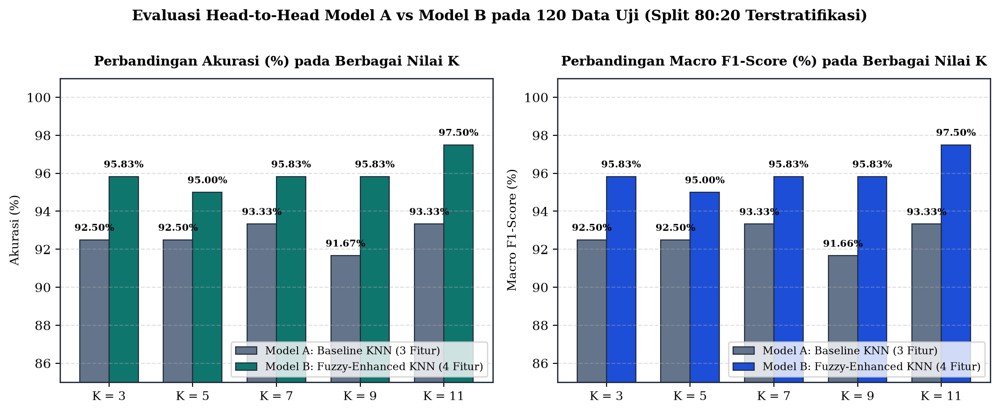

**Gambar 4.1** Grafik Perbandingan Akurasi dan *Macro F1-Score* Model A vs Model B pada $K = 3, 5, 7, 9, 11$

### 4.6.2 Evaluasi Metrik Per Kelas dan Matriks Konfusi pada $K = 5$

Pada konfigurasi standar $K = 5$, Model B berhasil meningkatkan *precision*, *recall*, dan *F1-score* di kedua kelas sekaligus menurunkan jumlah kesalahan klasifikasi dari 9 sampel menjadi 6 sampel (pengurangan kesalahan sebesar 33.3%). Rincian metrik per kelas dan matriks konfusi ditampilkan pada **Tabel 4.6**, **Tabel 4.7**, dan **Gambar 4.2**.

**Tabel 4.6** Perbandingan Metrik Per Kelas Model A vs Model B pada $K = 5$

| Kelas Kelayakan | Support | Precision A | Precision B | Recall A | Recall B | F1-Score A | F1-Score B |
| :--- | :---: | :---: | :---: | :---: | :---: | :---: | :---: |
| `Not Potable (0)` | 60 | 90.48% | **93.55%** | 95.00% | **96.67%** | 92.68% | **95.08%** |
| `Potable (1)` | 60 | 94.74% | **96.55%** | 90.00% | **93.33%** | 92.31% | **94.92%** |
| **Rata-Rata** | **120** | **92.61%** | **95.05%** | **92.50%** | **95.00%** | **92.50%** | **95.00%** |

**Tabel 4.7** Perbandingan Matriks Konfusi (*Confusion Matrix*) Model A dan Model B pada $K = 5$

| Model | Aktual \ Prediksi | Prediksi `Not Potable (0)` | Prediksi `Potable (1)` | Total Kesalahan |
| :--- | :--- | :---: | :---: | :---: |
| **Model A (3 Fitur)** | Aktual `Not Potable (0)` | **57** ($TN$) | 3 ($FP$) | 9 sampel |
| **Model A (3 Fitur)** | Aktual `Potable (1)` | 6 ($FN$) | **54** ($TP$) | (Akurasi 92.50%) |
| **Model B (4 Fitur)** | Aktual `Not Potable (0)` | **58** ($TN$) | 2 ($FP$) | **6 sampel** |
| **Model B (4 Fitur)** | Aktual `Potable (1)` | 4 ($FN$) | **56** ($TP$) | (**Akurasi 95.00%**) |

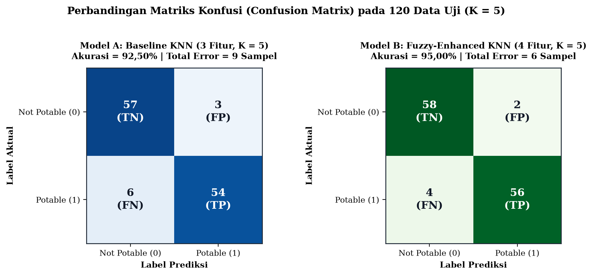

**Gambar 4.2** Perbandingan Matriks Konfusi (*Confusion Matrix*) Model A vs Model B pada $K = 5$

### 4.6.3 Pembahasan Pengaruh Fitur Skor Fuzzy pada Daerah Batas

Pada ruang 3 dimensi asli, jarak Euclidean memperlakukan `ph`, `Hardness`, dan `Turbidity` secara terpisah sehingga dua sampel dengan interaksi risiko berbeda dapat terlihat berdekatan. Penambahan dimensi keempat berupa `fuzzy_quality_score` menyuntikkan informasi non-linear dari 27 aturan pakar ke dalam metrik jarak KNN. Dampaknya, sampel air di daerah batas (*decision boundary*) lebih jelas terpisah berdasarkan indeks kelayakan menyeluruhnya, sehingga baik *False Positive* maupun *False Negative* berkurang.

## 4.7 Analisis Kelebihan dan Keterbatasan Sistem

Kelebihan utama sistem ini adalah transparansi penuh (*white-box*) karena seluruh tahap Fuzzy Mamdani dan KNN dibangun *from scratch*, akurasi klasifikasi yang konsisten meningkat (+2.50% hingga +4.17%), serta ketersediaan antarmuka Streamlit yang interaktif. Sementara itu, keterbatasan sistem terletak pada cakupan input Fuzzy Mamdani yang baru menggunakan 3 parameter fisik-kimia dan parameter segitiga yang masih ditetapkan secara manual berbasis literatur, belum dioptimasi otomatis terhadap data lapangan lokal.

# BAB V
# PENUTUP

## 5.1 Kesimpulan

1. Sistem Pendukung Keputusan penentuan kualitas dan kelayakan air minum berbasis kombinasi **Fuzzy Mamdani** (3 input, fungsi keanggotaan segitiga simetris, 27 aturan, Centroid analitik) dan **K-Nearest Neighbor (KNN)** telah berhasil dibangun *from scratch* menggunakan Python dan antarmuka Streamlit 6 halaman.
2. Verifikasi antara perhitungan manual dan keluaran program pada sampel referensi `S4` ($z^* = 55.9524$) maupun kasus uji baru `Q*` ($z^* = 54.1667$, prediksi `Potable` pada $K = 3$) menghasilkan selisih absolut `0.0000`, serta prediksi KNN *from scratch* cocok 100% dengan `scikit-learn`.
3. Integrasi fitur `fuzzy_quality_score` pada Model B (4 fitur) secara konsisten mengungguli Model A (Baseline KNN 3 fitur) di seluruh nilai $K \in \{3, 5, 7, 9, 11\}$, dengan peningkatan akurasi sebesar +2.50% hingga +4.17% dan pencapaian akurasi tertinggi sebesar 97.50% pada $K = 11$ (95.00% pada $K = 5$).
4. Pengurangan kesalahan klasifikasi dari 9 sampel menjadi 6 sampel pada $K = 5$ membuktikan bahwa fitur hasil inferensi pakar Fuzzy Mamdani efektif memperkuat pemisahan kelas KNN di area perbatasan.

## 5.2 Saran Pengembangan Selanjutnya

1. Menambahkan parameter kualitas air lain seperti `Chloramines`, `Solids`, atau indikator mikrobiologis untuk memperkaya basis pengetahuan pakar.
2. Menerapkan optimasi parameter fungsi keanggotaan secara adaptif (misalnya menggunakan *Genetic Algorithm* atau ANFIS) agar batas himpunan fuzzy semakin presisi.
3. Mengeksplorasi varian *Fuzzy K-Nearest Neighbor* (FKNN) berbobot jarak guna menghasilkan probabilitas keanggotaan kelas yang lebih halus.

# DAFTAR PUSTAKA

1. **Cover, T., & Hart, P.** (1967). Nearest neighbor pattern classification. *IEEE Transactions on Information Theory*, 13(1), 21-27. https://doi.org/10.1109/TIT.1967.1053964
2. **Kadiwal, A.** (2021). *Water Quality and Potability Dataset* [Data set]. Kaggle Repository. https://www.kaggle.com/datasets/adityakadiwal/water-potability
3. **Keller, J. M., Gray, M. R., & Givens, J. A.** (1985). A fuzzy K-nearest neighbor algorithm. *IEEE Transactions on Systems, Man, and Cybernetics*, SMC-15(4), 580-585. https://doi.org/10.1109/TSMC.1985.6313426
4. **Kementerian Kesehatan Republik Indonesia.** (2023). *Peraturan Menteri Kesehatan Republik Indonesia Nomor 2 Tahun 2023 tentang Peraturan Pelaksanaan Peraturan Pemerintah Nomor 66 Tahun 2014 tentang Kesehatan Lingkungan*. Jakarta: Kemenkes RI.
5. **Kusumadewi, S., & Purnomo, H.** (2010). *Aplikasi Logika Fuzzy untuk Pendukung Keputusan* (Edisi ke-2). Yogyakarta: Graha Ilmu.
6. **Mamdani, E. H., & Assilian, S.** (1975). An experiment in linguistic synthesis with a fuzzy logic controller. *International Journal of Man-Machine Studies*, 7(1), 1-13. https://doi.org/10.1016/S0020-7373(75)80002-2
7. **Ross, T. J.** (2016). *Fuzzy Logic with Engineering Applications* (4th ed.). Chichester: John Wiley & Sons.
8. **World Health Organization (WHO).** (2022). *Guidelines for Drinking-water Quality: Fourth Edition Incorporating the First and Second Addenda*. Geneva: World Health Organization.
9. **Zadeh, L. A.** (1965). Fuzzy sets. *Information and Control*, 8(3), 338-353. https://doi.org/10.1016/S0019-9958(65)90241-X

# LAMPIRAN

## Lampiran 1: Pembagian Tugas Anggota Kelompok 1

**Tabel L.1** Pembagian Tugas dan Kontribusi Anggota Kelompok 1

| No. | Nama / NIM | Tanggung Jawab | Kontribusi Konkret | Bukti Pekerjaan |
| :---: | :--- | :--- | :--- | :--- |
| 1 | **Nathanael Adrian Wattimena**<br>`2408561013` | Ketua Kelompok, Analisis Masalah & Laporan (BAB I-II) | Koordinasi tim, perumusan masalah, studi literatur standar air minum WHO & Permenkes RI, penyusunan Bab I, Bab II, dan penyuntingan akhir laporan. | BAB I, BAB II, dan koordinasi progres proyek. |
| 2 | **I Wayan Arya Adi Guna**<br>`2408561019` | Data Cleaning, Preprocessing & Eksplorasi Dataset | Pembersihan dataset Kaggle 3.276 baris menjadi 600 sampel seimbang, penghapusan *missing values*, penyusunan 5 sampel referensi (`S1`-`S5`), dan analisis statistik deskriptif. | `src/prepare_dataset.py`, `data/processed/*.csv`, Subbab 3.2. |
| 3 | **Komang Dhika Artika Nurdi**<br>`2408561055` | Implementasi Fuzzy Mamdani & Perhitungan Manual | Implementasi kurva segitiga simetris, 27 basis aturan (`R01`-`R27`), mesin inferensi MIN-MAX, defuzzifikasi Centroid analitik, serta verifikasi perhitungan manual `S4` dan `Q*`. | `src/fuzzy_mamdani.py`, Subbab 3.3, 3.5, 4.3.1-4.3.2, dan `tests/test_system.py`. |
| 4 | **Kadek Phatra Adisuta Timonuli**<br>`2408561076` | Implementasi KNN, Integrasi & Evaluasi Model | Implementasi `MinMaxScalerScratch`, `ZScoreScalerScratch`, `KNNClassifierScratch`, integrasi fitur `fuzzy_quality_score`, evaluasi Model A vs Model B lintas $K$, dan validasi 100% terhadap `scikit-learn`. | `src/knn_model.py`, `docs/experiment_results.json`, Subbab 4.3.3, 4.6, dan BAB V. |
| 5 | **I Putu Maichail Ganio Wijaya**<br>`2408561123` | Streamlit UI, Visualisasi Chart & Dokumentasi | Pengembangan antarmuka GUI Streamlit 6 halaman modular, visualisasi interaktif Plotly, grafik laporan Matplotlib 200 DPI, serta panduan penggunaan aplikasi. | `app.py`, `src/ui/`, `src/utils/generate_report_figures.py`, Subbab 3.6 & 4.5. |

## Lampiran 2: Data 5 Sampel Referensi Perhitungan Manual (`manual_calc_sample.csv`)

**Tabel L.2** Data Lengkap 5 Sampel Referensi Perhitungan Manual

| Kode | Sample ID | `ph` | `Hardness` (mg/L) | `Turbidity` (NTU) | `fuzzy_quality_score` | `Solids` (ppm) | `Chloramines` (ppm) | `Conductivity` (μS/cm) | Kelas Kelayakan |
| :---: | :---: | :---: | :---: | :---: | :---: | :---: | :---: | :---: | :---: |
| S1 | WQP-M01 | 3.50 | 240.0 | 4.750 | 44.0476 | 28450.0 | 8.20 | 512.4 | Not Potable (0) |
| S2 | WQP-M02 | 10.50 | 240.0 | 4.750 | 44.0476 | 26120.0 | 7.85 | 498.2 | Not Potable (0) |
| S3 | WQP-M03 | 7.00 | 180.0 | 3.500 | 50.0000 | 21500.0 | 7.10 | 425.0 | Not Potable (0) |
| S4 | WQP-M04 | 7.00 | 120.0 | 2.250 | 55.9524 | 16800.0 | 6.80 | 380.5 | Potable (1) |
| S5 | WQP-M05 | 7.00 | 90.0 | 1.625 | 64.6739 | 14200.0 | 6.50 | 345.0 | Potable (1) |

## Lampiran 3: Petunjuk Instalasi dan Penggunaan Aplikasi

```bash
# 1. Buat dan aktifkan virtual environment
python3 -m venv .venv
source .venv/bin/activate

# 2. Instal pustaka yang dibutuhkan
pip install -r requirements.txt

# 3. Jalankan pengujian otomatis (opsional)
python3 -m pytest -q

# 4. Jalankan aplikasi GUI Streamlit
streamlit run app.py
```

## Lampiran 4: Tangkapan Layar Aplikasi GUI Streamlit

Berikut 6 tangkapan layar antarmuka GUI Streamlit (`http://localhost:8501`) yang diambil langsung dari aplikasi akhir Kelompok 1:

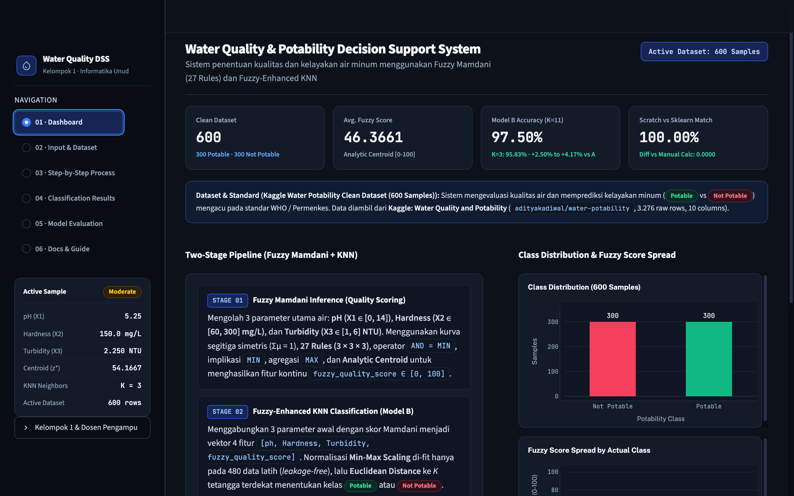

**Gambar L.1** Halaman `01 · Dashboard`: ringkasan dataset 600 sampel, Two-Stage Pipeline, KPI Model B, distribusi kelas, dan profil Kelompok 1

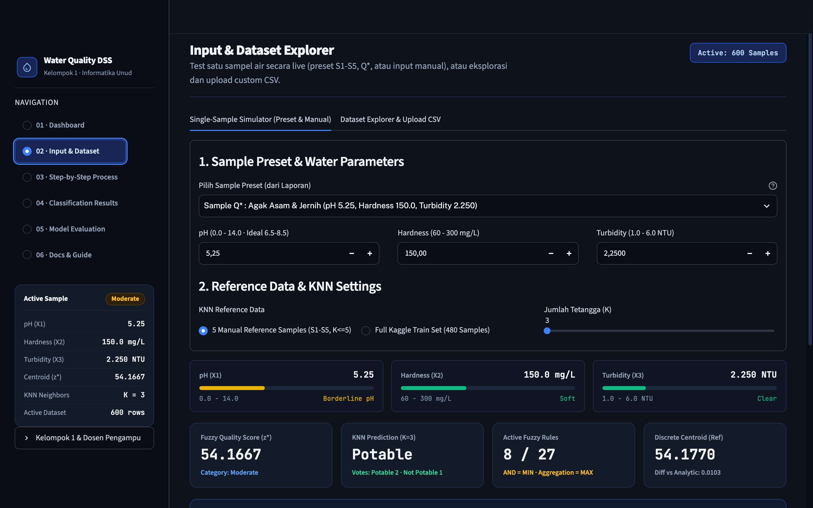

**Gambar L.2** Halaman `02 · Input & Dataset`: Single-Sample Simulator, preset `S1`-`S5` dan `Q*`, validasi input, serta fitur Upload Custom CSV

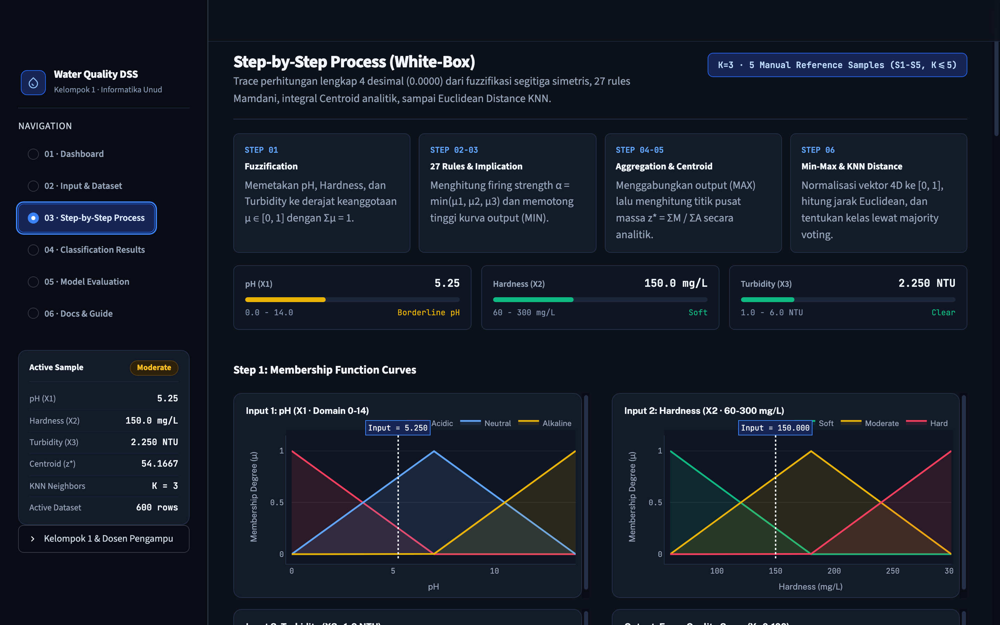

**Gambar L.3** Halaman `03 · Step-by-Step Process`: trace perhitungan *white-box* kurva Membership Function, 27 rule, agregasi MAX, Centroid analitik, dan jarak Euclidean KNN

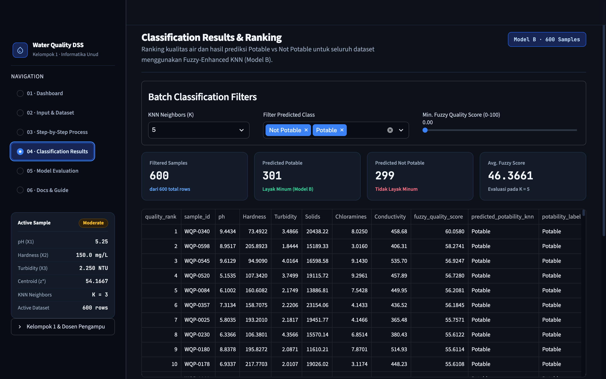

**Gambar L.4** Halaman `04 · Classification Results`: ranking kualitas air seluruh dataset, filter kelas dan minimum Fuzzy Score, ekspor CSV, serta grafik distribusi

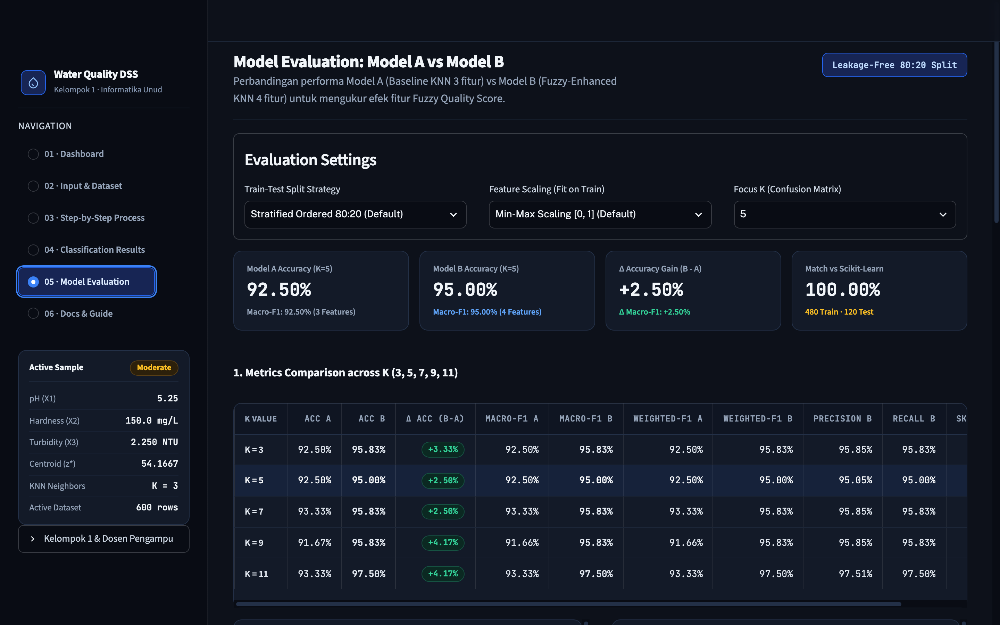

**Gambar L.5** Halaman `05 · Model Evaluation`: komparasi Model A vs Model B lintas $K \in \{3, 5, 7, 9, 11\}$, grafik sensitivitas $K$, *Confusion Matrix*, dan metrik per kelas

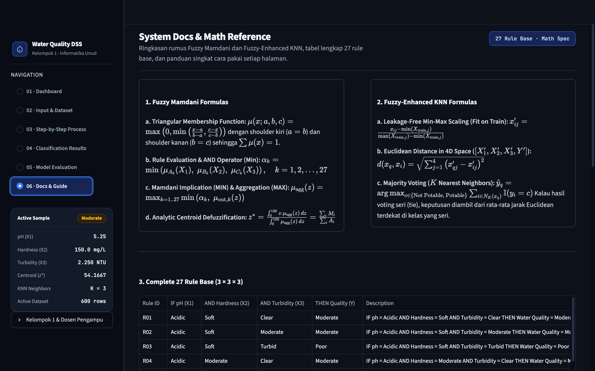

**Gambar L.6** Halaman `06 · Docs & Guide`: referensi rumus matematis Fuzzy Mamdani dan KNN, tabel 27 *rule base*, serta panduan penggunaan aplikasi

